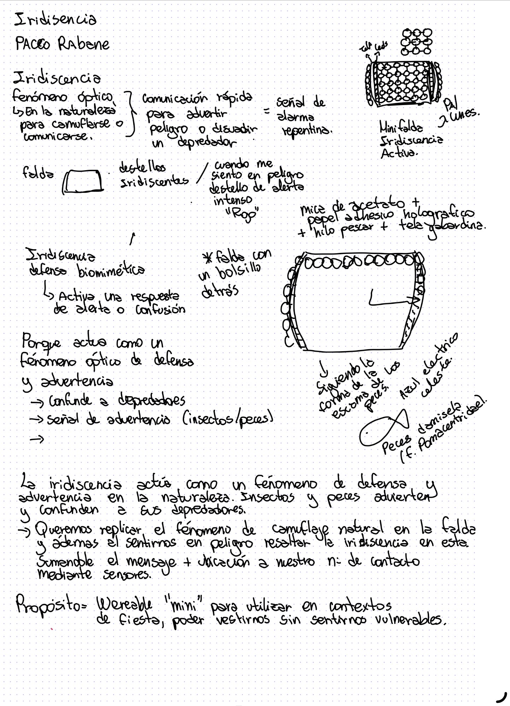

# Corrección del proyecto: Iridiscencia

## 1. Proyecto
Para esta entrega presentamos el desarrollo de una minifalda interactiva (*wearable*) inspirada en el trabajo de Paco Rabanne y el fenómeno óptico de la iridiscencia presente en la naturaleza. El propósito del objeto es ser utilizado en contextos de fiesta para que las personas puedan vestirse libremente sin sentirse vulnerables (especialmente mujeres), funcionando como un mecanismo de defensa biomimético y señal de advertencia.

La prenda está construida sobre una base de tela. Incorpora una serie de circulos compuestos por mica de acetato y  papel adhesivo holográfico, las cuales van unidas y articuladas mediante hilo de pescar. La estructura sigue la curva de las escamas de los peces damisela (*f. Pomacentridae*) y cuenta con un bolsillo en la parte trasera para alojar los componentes electrónicos.

## 2. Funcionamiento e interacción
El sistema actúa como un fenómeno de defensa, advertencia y confusión frente a "depredadores" o amenazas en el entorno, replicando el comportamiento de insectos y peces en la naturaleza mediante sensores:

**Mimetismo:** La falda mantiene reflejos y destellos iridiscentes continuos en tonos azul eléctrico y celeste, emulando el camuflaje natural.
**Respuesta de alerta (Sensor de proximidad):** Al detectar una amenaza o cuando la persona se siente en peligro, el sistema activa una respuesta rápida de alarma. Las luces LED reaccionan de inmediato emitiendo un destello de alerta intenso en tono **Rojo** para disuadir, advertir o confundir.
**Comunicación de emergencia:** Sumado al mensaje visual de alerta, el sistema integra la función de enviar la ubicación a un número de contacto de emergencia.

## 3. Corrección y retroalimentación
Durante la corrección, los profesores nos señalaron que la propuesta conceptual de la iridiscencia activa como defensa biomimética es muy potente pero debemos de enfocarnos en hacer que cada componente de la falda parezca uno.

**Presentación e integración:** Nos indicaron que debemos mejorar la forma en que comunicamos el proyecto y cómo se integran los módulos electrónicos. Reconocemos que debemos equilibrar el esfuerzo entre la confección textil, la soldadura del circuito y la narrativa conceptual.
**Construcción y flexibilidad:** Se recomendó perfeccionar la articulación de las micas con el hilo de pescar sobre la gabardina, buscando que el movimiento de las escamas sea más fluido al caminar y no entorpezca la visual de los LED o el volumen de la prenda.
**Respuesta del sistema:** En cuanto a la programación y los sensores, nos sugirieron calibrar el umbral de distancia para que el cambio entre la luz turquesa/celeste y el destello rojo de alerta sea inmediato pero no sufra falsos disparos por el propio movimiento de la falda.

## 4. Aspectos por mejorar
**Montaje y confección** 
**Integración electrónica** 
**Programación y conectividad** 
**Presentación**

# Clase 12
# Vibe Coding y Metodología de Trabajo con IA

##  ¿Qué es el Vibe Coding?
Es programar describiendo ideas en **lenguaje natural** (la forma en que nos comunicamos con las personas) hacia una máquina, utilizando una interfaz de Inteligencia Artificial como canal de desarrollo.

## Ciclo de Trabajo (Iteración)

1. **Describir:** Expresar la interacción en palabras simples.
2. **Generar:** La IA transcribe la idea y describe el código.
3. **Verificar:** Revisar asignación de pines, librerías, rangos y parámetros técnicos (evita que los componentes se quemen).
4. **Probar:** Cargar el código compilado directamente al ESP32.
5. **Observar:** Evaluar si el comportamiento físico coincide con lo requerido. *(Si no resulta, se vuelve al paso 1)*.

**Regla de oro:** Verificar siempre el código antes de cargar para evitar sobrecargas o quemar componentes electrónicos.

##  Criterio: *"La IA propone, el diseñador decide"*

El proceso requiere **Intención, Juicio y Comprensión**:
**Sin intención clara:** La IA tomará las decisiones de diseño por ti.
**Sin capacidad de selección:** Aceptaras cualquier propuesta sin evaluar alternativas.
**Sin comprensión del código:** No podrás explicar ni argumentar el funcionamiento del proyecto.

## Delegación de Tareas

### Lo que SÍ se delega a la IA:
* Sintaxis del lenguaje de programación.
* Estructuración general del código.
* Inclusión de librerías.
* Solución de elementos técnicos específicos.

### Lo que NO se delega (Rol del Diseñador):
* La definición del alcance y cierre del proyecto.
* La experiencia emocional y lo que debe sentir la persona al interactuar.
* La toma de decisiones finales entre distintas alternativas.
* Definir si el circuito y la estructura son seguros para el usuario y los componentes.

 *"El oficio se entrena: en cada vuelta, cambia a mano al menos un valor y observa qué pasa en el comportamiento del objeto."*

## Advertencias y Cuidados sobre la IA
La IA no posee contexto físico de tu montaje:
**No conoce los pines físicos** reales de tu placa.
**No sabe la fuente de alimentación** o batería que estás utilizando.
**No percibe la sensación sensorial** ni el efecto en el espacio.
**No reemplaza la revisión del pinout** técnico del ESP32.

## Estructura de un Prompt Efectivo

Para obtener código funcional, la instrucción (prompt) debe incluir 4 componentes clave:

1. **Contexto:** Entregar a detalle los materiales y componentes con los que se trabaja.
2. **Comportamiento:** Describir paso a paso qué debiese suceder en la interacción.
3. **Restricciones:** Definir límites claros (brillo máximo, uso de `delay()`, rangos de sensores).
4. **Formato de entrega:** Pedir el código completo, comentado y con la lista explícita de conexiones.

## Estrategias para Prompts Complejos

Al solicitar interacciones avanzadas, se recomienda seguir estos principios de diálogo con la IA:

**Pedir preguntas previas:** *"Hazme 3 preguntas sobre lo que no haya quedado claro antes de escribir el código"*.
**Solicitar alternativas:** Pedir distintas opciones de lógica para elegir la mejor.
**Lógica primero:** Pedir que desglose el diagrama de flujo o la estructura lógica antes de programar.
**Construir por etapas:** Progresar desde lo más simple hacia lo complejo.
**Formular hipótesis:** Escribir la hipótesis del resultado esperado antes de generar el código.

## Máquina de Estados (Crear interacciones complejas)

Para coordinar interacciones avanzadas (por ejemplo, comportamientos tipo mosaico o sensores de emergencia por toques), la lógica debe contemplar los siguientes estados:

Reposo - Input - Trigger - Output - Transición - Retorno - Feedback

