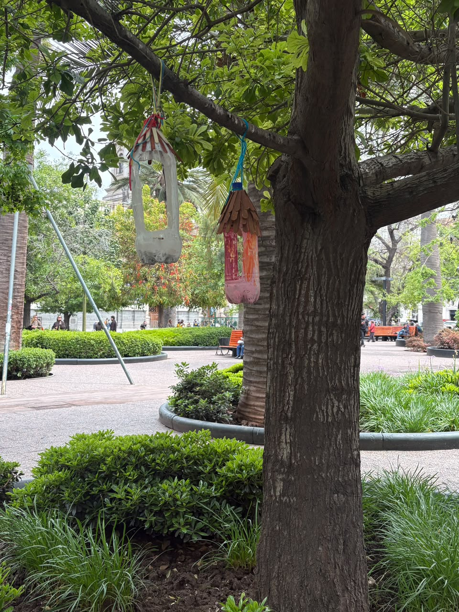
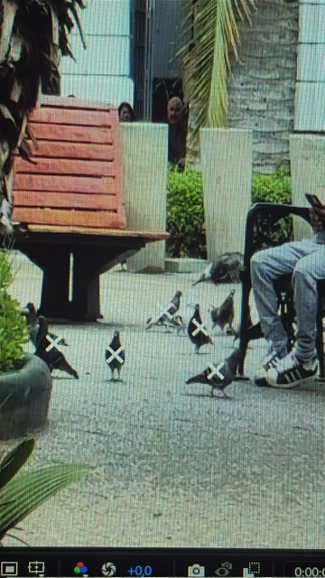

## Apuntes de Observación de Campo, Clases 17-18
**Fecha:** Vi 23 (12:20) Plaza de armas

---

## 1. Observaciones en el Entorno
* Todas en comunidad (vuelan juntas).
* Vuelan entre las personas.
* Caminan entre las personas.
* Pájaros más pequeños.
* Palomas parte de la sociedad.
* Por 20 palomas, 2 pájaros pequeños.
* Se posan en faroles.
* Mayor seguridad en el sector.
* Perro negro que persigue carabineros.
* Habitan únicamente dentro de la plaza.
* Agua con químicos (Municipalidad).
* * Palomas gobiernan Plaza de Armas.
* Personas que pasean con sus perros.

**Imagenes interesantes**

---

## 2. Preguntas y Reflexiones Críticas
* ¿Qué pasaría si las palomas tuvieran cámaras en los ojos?
* ¿Qué pasaría si nosotros fuéramos palomas?
* ¿Qué pasa si las palomas nos ven como una parte de su especie?
* ¿Le tememos más a las palomas que nosotras a ellas?

---
**LLegamos a un proyecto funcional que finalmente fue rechazado**

## 3. Notas Laterales y Conceptos
* **Coexistencia interespecie**
* **Apropiación de espacios públicos**
* **Adaptación**
* **Julius von Bismarck** -> Algunas palomas son más iguales que otras.
## Apuntes de Observación y Referentes Artísticos

### Referente: Wim Delvoye
* *Is no stranger to controversy*
* **Chanchos tatuados**

### Conceptos y Referentes Adicionales
* Conejo neón.
* Ars Electronica.
* Butterflies marketing Coca-Cola. -> **Formas de entender comportamientos.**

## Idea Final del Grupo
* **Idea Proyectual:** Como grupo llegamos a la idea final de realizar un proyecto donde **crearemos música mediante las palomas y su aleteo**.

**Avance**

